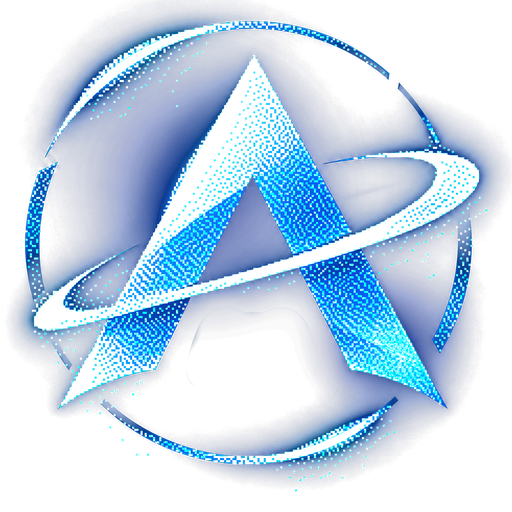

<p align="center">
  
</p>

<h1 align="center">Arcadia</h1>

<p align="center">
  <b>All your emulators, one app.</b><br>
  A Steam-like library for your own game backups: drop a ROM, Arcadia handles the rest.<br>
  <i>Tous tes émulateurs, une seule app. — README en français plus bas.</i>
</p>

---

## What it is

Arcadia is a Windows game launcher that turns emulators into **engines**: you only ever see Arcadia's interface — library, game pages, in-game menu, saves — whatever the console.

- **Built-in engine** (`arcadia-runner`, libretro cores): PSP, DS, 3DS, PS1, NES, Super Nintendo, Game Boy / Color / Advance. Fullscreen, no emulator window, Arcadia in-game menu (Esc or Guide), save states with thumbnails, automatic resume.
- **External engines** for the rest (Switch, PS2, PS3, Wii U…): launched without their UI, with the Arcadia menu overlaid on top (pause, settings, save backups, language, controls).
- **Controller *and* keyboard at the same time**, in every game. One-press controller calibration ("press A"), even in game.
- **Game language** picked from the languages actually present in the ROM (Switch, 3DS).
- **Library**: icons and covers read from the ROMs and free databases, favorites, categories, playtime, Couch mode for the TV, drag & drop import, save backups with cloud-folder sync.
- **Arcadia Switch engine** (Switch 1 & 2): a fork of Lichii / Eden / yuzu (GPL-3.0) driven by Arcadia — controller + keyboard + mouse, rumble, in-game menu, live video settings. Sources: branch [`arcadia-switch-lichii`](../../tree/arcadia-switch-lichii).
- **Automatic 60 FPS patches** for Switch, PSP and PS1 games that have one, from public community databases (NX-60FPS-RES-GFX-Cheats, CWCheat-Database-Plus, DuckStation chtdb).
- **In-game FPS counter**, NVIDIA DLSS for Switch 2 games, custom wallpapers with automatic button palette, neon interface.

> ⚠️ **Arcadia is still in development.** If something major breaks, come and tell us on [Discord](https://discord.gg/7XczndQEsG).

> **Arcadia ships no games, BIOS, keys or firmware**, and never will. Use dumps of games and consoles you own. Arcadia is not affiliated with Nintendo, Sony, Microsoft or any console maker.

## Repository layout

| Path | What |
|---|---|
| `main.js`, `preload.js`, `src/`, `renderer/` | The Electron app (library, game pages, overlay menu) |
| `native/runner/` | `arcadia-runner`: C++ / SDL3 / OpenGL / Dear ImGui host for libretro cores + in-game menu + controller calibration |
| `native/helper/` | `arcadia-helper`: small native companion (pause/resume, focus, window branding, controllers via SDL, DSU server merging controller + keyboard for Switch engines) |
| `runner/` | Where the built engine, cores and companion are placed before packaging (`LICENCES.txt` lists every component) |
| `build/` | Icons, NSIS installer script |
| `test/` | `npm test` |

## Building

**App** (Node 20+):
```bash
npm install
npm start          # dev
npm test
npx electron-builder --win dir --x64   # then build/installer.nsi with makensis
```

**Native engine + companion** (from Linux with MinGW-w64, POSIX threads):
```bash
native/build-windows.sh   # fetches SDL3, Dear ImGui, stb, builds runner/arcadia-runner.exe and runner/arcadia-helper.exe
```

**Cores**: build the libretro cores from their official sources (links in `runner/LICENCES.txt`) and put the DLLs in `runner/cores/`:
`ppsspp_libretro`, `melonds_libretro`, `azahar_libretro`, `pcsx_rearmed_libretro`, `mesen_libretro`, `bsnes_libretro`, `mgba_libretro`.

## License & credits

Arcadia is free software under the **GNU GPL v3.0** (see `LICENSE`).
It stands on the shoulders of PPSSPP, melonDS, Azahar/Citra, PCSX ReARMed, Mesen, bsnes, mGBA, Eden, SDL, Dear ImGui and stb: full list and licenses in [`runner/LICENCES.txt`](runner/LICENCES.txt).

Made solo by **Ivex**. Questions, bugs, a game that won't start: [Discord](https://discord.gg/7XczndQEsG).

---

## 🇫🇷 En français

Arcadia est un lanceur de jeux pour Windows qui transforme les émulateurs en **moteurs** : tu ne vois que l'interface d'Arcadia (bibliothèque, pages de jeu, menu en jeu, sauvegardes), quelle que soit la console.

- **Moteur intégré** : PSP, DS, 3DS, PS1, NES, Super Nintendo, Game Boy / Color / Advance. Plein écran, menu Arcadia (Échap ou Guide), sauvegardes instantanées avec miniatures, reprise automatique.
- **Moteurs externes** (Switch, PS2, PS3, Wii U…) lancés sans leur interface, avec le menu Arcadia par-dessus.
- **Manette et clavier en même temps** dans tous les jeux, calibrage « appuie sur A », même en jeu.
- **Langue du jeu** choisie parmi les langues présentes dans la ROM.

**Arcadia ne fournit aucun jeu, BIOS, clé ni firmware.** Utilise les copies de tes propres jeux et consoles.

Projet solo créé par **Ivex** — contact : [Discord](https://discord.gg/7XczndQEsG).
